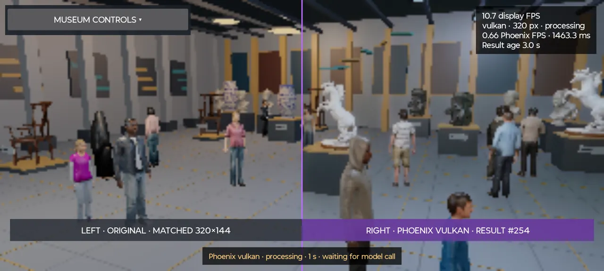
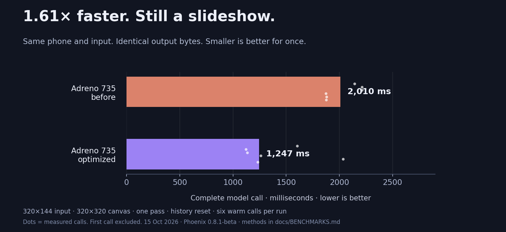
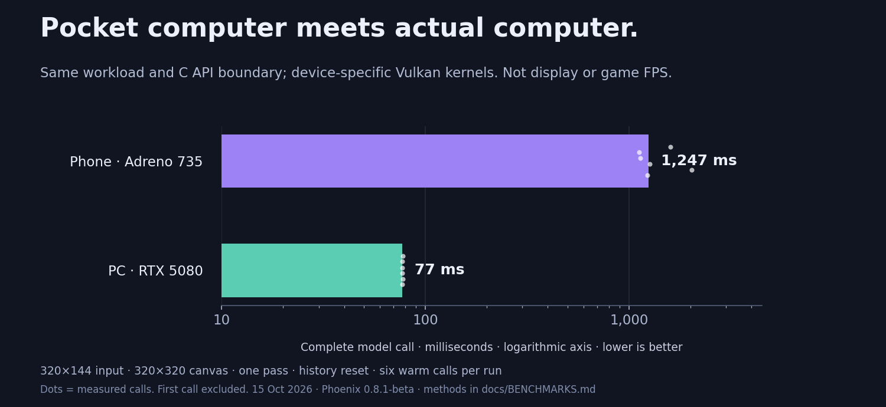

# Can your phone run DLSS5?

- **Well, it can. It will suck.** Unless I actually manage to optimize things.
- **Phoenix Museum for Android**: experimental reconstruction of DLSS5 neural rendering. A deeply unreasonable workload for a pocket computer.
- Independent project; **not an official NVIDIA Android SDK**. The model DLL is read as data.

### Features, including the consequences

- Museum: 316 objects, 16 visitors, two animals. Drag to orbit; pinch to zoom.
- **CPU / Vulkan** switch; optional **64/128-thread compatibility**. No sneaky CPU fallback.
- Split/difference views, freeze comparisons and [all the knobs](docs/APP.md).
- Separate **display / Phoenix FPS** counters. Repainting yesterday's result does not count as new intelligence.

### Your phone versus a PC. Place your bets.

| Same 320×144 model input¹ | Warm call | Calls/second² |
| --- | ---: | ---: |
| Adreno 735, before optimization | 2,010 ms | 0.50 |
| Adreno 735, optimized | 1,247 ms | 0.80 |
| RTX 5080, portable Vulkan | 77 ms | 12.96 |

- **1.61× faster on the phone. Still a slideshow.** PC: **16× faster**, identical output bytes.
- Screen-on: **0.65 Phoenix FPS**, **12.24 display FPS**. The museum moves faster than the thinking.
- ¹ One pass, eight blocks once, 320×320 canvas, history reset; six warm calls. Device-specific Vulkan kernels differ.
- ² `1000 / median ms`, not game FPS. [Samples and methods](docs/BENCHMARKS.md).

### Want to actually use DLSS? Start here.

- [**Phoenix**](https://github.com/RazvanManolache/dlss5-phoenix-addon): runtime, libraries and serious optimization.
- [**DLSS5 Everything**](https://github.com/RazvanManolache/DLSS5-Everything): Windows games, including the stubborn old ones.
- [**DOSBox Enhanced**](https://github.com/RazvanManolache/dosbox-enhanced): apparently DOS games needed neural rendering too.
- [**Desktop gallery**](https://github.com/RazvanManolache/dlss5-quality-vs-performance-gallery): original museum and quality/performance experiments.

### Small repo. Large ambitions.

- **Pinned submodules**, with lean gallery checkout. Weights, DLLs, APKs and museum assets stay outside Git.
- [Build locally](docs/BUILD.md): Android 9+, ARM64, OpenGL ES 3; Phoenix-compatible compute for Vulkan. Bring patience.
