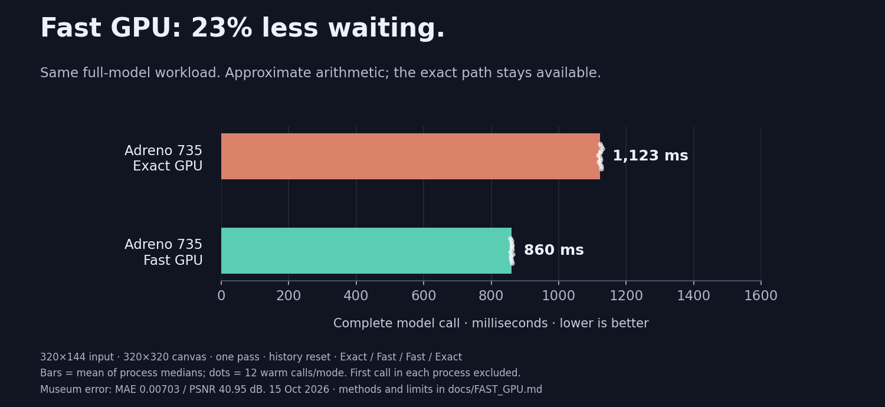

# Fast GPU, and an actual NPU prototype

- **Fast GPU is implemented:** enable **Fast GPU (approximate arithmetic)** beneath the Vulkan controls. Leave it off for the exact/reference path. It automatically uses the compatible workgroup route; CPU selection still runs the CPU reference.
- HUD and processed-result badges identify actual completed Fast/Exact results. Switching modes recreates the inference session after the current call finishes. An SDK without the new feature is rejected before inference, rather than silently ignoring the switch.
- Matrices use 128 invocations, native FP16 partial sums over 32 terms, FP32 outer accumulation and a fixed, unrolled inner loop. Half conversions and selected normalization/publication arithmetic use hardware instructions. Model, graph, input dimensions, working surface, block repeats and passes are unchanged. Weights remain packed; the experiment that doubled weight storage did not earn its memory cost and is not enabled.

## Measured on the phone

| Matching full-model workload | Complete warm call | Capacity, not display FPS |
| --- | ---: | ---: |
| Exact Vulkan | 1,123.30 ms | 0.89 calls/s |
| Fast GPU | 860.26 ms | 1.16 calls/s |

- **1.31× faster / 23.42% less waiting.** Still nowhere near real-time. Date: 15 October 2026; Motorola Edge 50 Ultra, SM8635 / Adreno 735; Phoenix `b63b539`.
- Four serial processes in **Exact / Fast / Fast / Exact** order, seven calls each; first excluded. Figures average the two process medians per mode. All warm samples and cold calls are in [the receipt](fast-gpu-results.json).
- Same 320×144 RGB32F input/motion, 320×320 working canvas, one pass, eight blocks once, reset history and controls as the earlier benchmark. Complete synchronous C API calls include packing, transfers, execution and resolve; exclude drawing/presentation and session creation. The app was stopped during this headless measurement. Clocks were not locked; no sustained thermal/battery result is claimed.
- Exact output still matches the published CPU/reference SHA-256. Fast output differs: **MAE 0.00703, maximum 0.04153, unit-range PSNR 40.95 dB** on the museum fixture. This is measured numerical error, not a claim that every difference is invisible.
- Black, white and gradient inputs plus a changed-style/control museum case all produce finite results. Their measured PSNR ranges **47.38–64.98 dB**. Five frames with history enabled after the first yield **40.91–42.18 dB** against the corresponding exact frames. This is a frozen-input sequence, not an animated-scene or long-term temporal-quality certification.
- Five fast GEMM cases check odd extents, K tails, transposed/non-transposed operands, strided batches and unwritten padding. All **47 existing shader binaries remain byte-identical** to SDK 0.8.1-beta; the approximate variants are separate.



## Hexagon / QNN: implemented experiment, separate from the app backend

- The phone executes a **real captured Phoenix projection** on **QNN HTP**, with **8-bit weights and 16-bit activations**, without CPU fallback. Its FP16 graph attempt was rejected by this device/runtime with validation error 3110. That is why the working experiment uses W8A16.
- The larger prototype executes the first **32,768-row window batch of block 0's feed-forward residual subgraph** entirely on HTP: expansion matrix, polynomial gate, contraction matrix and learned residual. It does **not** include window attention, the remaining window batches or full-model inference. Linear quantization replaces the reference's E4M3 publication grid.
- Default NPU graph: **41.36 ms**. Batching into 4,096 rows: **27.94 ms**. The same batched graph with a scoped burst performance hint: **9.43 ms**, including eight `graphExecute` calls and their host-plane I/O. Each process excludes two warmups and records 20 full-subgraph iterations. Input quantization/calibration, graph construction and presentation are outside these timings.
- The burst hint belongs to a QNN power-config handle and is released when the probe exits. These are short latency tests, not sustained power-efficiency measurements.
- For context, the captured exact Vulkan subgraph's GPU-only median is **16.23 ms**. Different timing boundaries, arithmetic and power policies: do not turn these numbers into a full-model speedup or app FPS claim.
- The NPU output's mean activation error is **0.00291**, maximum **0.04473** against that subgraph's exact output. These are activation units, not image-quality scores. Calibration uses this same fixture and reference intermediates; a production backend needs independent calibration/quality tests and the remaining operators.
- **The NPU prototype is separate from the app backend.** The app offers the validated full-model CPU/Vulkan paths. The NPU work is runnable under [tools/experiments](../tools/experiments), with its own measurement receipts.

## Run the probes locally

- Build the pinned Phoenix source with Vulkan as described in [BUILD.md](BUILD.md). Supply your own model and fixture. Captures contain model-derived weights/activations and belong in ignored `build/` or `evidence/`, not in Git or a source release.
- The ordinary `capture_projection` and `sequence_probe` tools require only the Android NDK and the Phoenix submodule. To also build QNN probes, separately obtain [Qualcomm QAIRT](https://www.qualcomm.com/developer/software/qualcomm-ai-engine-direct-sdk); this experiment used 2.44.0.260225. No QNN headers or binaries are included here or in the museum APK.

  ```sh
  cmake -S tools/experiments -B build/probes -G Ninja -DCMAKE_BUILD_TYPE=Release -DCMAKE_TOOLCHAIN_FILE="$ANDROID_HOME/ndk/27.3.13750724/build/cmake/android.toolchain.cmake" -DANDROID_ABI=arm64-v8a -DANDROID_PLATFORM=android-28 -DQNN_SDK=/path/to/qairt/2.44.0.260225
  cmake --build build/probes --parallel 4
  ```

- On the phone, put the model-free Phoenix SDK, the probe executables and your private job/fixture in a test folder. `LD_LIBRARY_PATH` must include the SDK libraries. Run `capture_projection JOB.json NEW_CAPTURE_FOLDER`, then `qnn_ffn_probe CAPTURE_FOLDER NEW_OUTPUT_FOLDER 68 4096 burst` for this SM8635 device.
- QNN execution also needs SDK `libQnnHtp.so`, `libQnnHtpPrepare.so`, `libQnnHtpV73Stub.so` and the matching unsigned `libQnnHtpV73Skel.so`. Configure `ADSP_LIBRARY_PATH` with that folder plus the device's DSP paths, and include the host libraries in `LD_LIBRARY_PATH`. Libraries and redistribution terms come from your separately obtained SDK. Device SoC IDs and DSP architecture differ; `68`/V73 here are not portable defaults.
- `sequence_probe JOB.json NEW_FOLDER` executes five frames, resetting only the first; it records actual history status. `tools/compare_output.py REFERENCE.rgb32f CANDIDATE.rgb32f --report evidence/error.json` reports finite checks, hashes, MAE, maximum error and PSNR. The [JSON receipt](fast-gpu-results.json) records all published samples and QNN runtime hashes.
